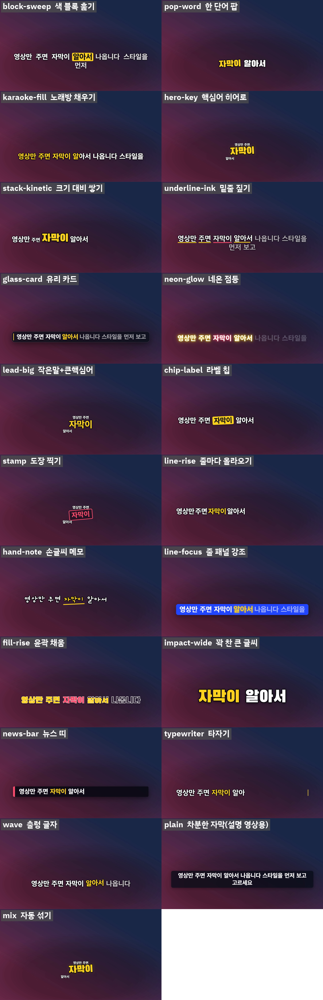

<p align="right"><b>English</b> | <a href="README.ko.md">한국어</a></p>

<p align="center"></p>

<p align="center">
<a href="https://github.com/reedodev/dynamic-captions/actions/workflows/test.yml"></a>


</p>

# dynamic-captions: automatic captions for your video

**You give it a video. It writes the words on the screen, in a style you choose.**

That is the whole idea. You do not draw anything or edit a timeline. The tool listens to your video, writes down every spoken word with its time, and shows you the same scene in 10+ caption styles. You pick the one you like, and it gives you a new video with the captions burned in.

It is a "skill" for Claude Code (an AI assistant from Anthropic that runs on your computer). You can use it by chatting with the assistant, or run the commands yourself. Both ways are explained below.

## Is this for me?

Yes, if you:
- make Shorts, Reels, TikToks or longer videos and want captions that look good without learning video editing,
- make music videos or lyric videos and want the lyrics to appear on time,
- want captions that stay out of the way: they do not hide faces, and they do not sit where YouTube shows its own subtitles.

## What makes it different

- **10+ looks + "mix".** Mix changes the look sentence by sentence, so the video does not feel repetitive.
- **Captions move around** (left, right, top, bottom), but never into the zones where apps put their own buttons or subtitles.
- **Faces are avoided.** It finds faces and puts captions somewhere else.
- **Text is never tiny.** If a caption would get too small, it moves to a wider spot.
- **Songs:** captions pulse gently on the beat, and the chorus (lines that repeat) appears bigger.
- **Lyrics are spelled right.** Speech recognition often mishears rap. If you have the real lyrics, the tool uses your spelling and the audio's timing. Where the two disagree, it cuts short clips so *you* can listen to just those spots.
- **Fast.** Several Chrome windows draw frames at the same time (a 75-second Full HD clip: 197 s → 64 s).

## Before you start: what to install

You need four free programs. If you already have them, skip ahead. Open a terminal (Windows: PowerShell; Mac: Terminal) and type the check command to see if each one is installed.

| Program | What it is for | Check it | How to get it |
|---|---|---|---|
| **Node.js** 18 or newer | runs the tool's scripts | `node -v` | https://nodejs.org (the "LTS" button) |
| **ffmpeg** | reads and writes video | `ffmpeg -version` | Windows: `winget install Gyan.FFmpeg` · Mac: `brew install ffmpeg` |
| **Google Chrome** (or Chromium) | draws the captions | just open Chrome once | https://www.google.com/chrome |
| **Python** 3.10 or newer | listens to the audio (Whisper) | `python --version` (on Windows sometimes `py --version`) | https://www.python.org |

Then install the Python helpers (one time, takes a few minutes and a few GB because of Whisper):

```bash
pip install openai-whisper numpy
pip install librosa                  # optional: beat detection for songs
pip install opencv-python-headless   # optional: face finding
```

> **Tip:** if you use Claude Code, you can simply say *"install everything dynamic-captions needs"* and let the assistant do the steps above and tell you what is missing.

An NVIDIA graphics card makes the final step faster, but it is not required.

## Install the skill

**Easiest: as a Claude Code plugin.** Type these two lines in Claude Code:

```
/plugin marketplace add reedodev/dynamic-captions
/plugin install dynamic-captions@dynamic-captions
```

**Or copy the folder yourself:**

```bash
git clone https://github.com/reedodev/dynamic-captions.git
cp -r dynamic-captions/skills/dynamic-captions ~/.claude/skills/
```

## Make your first captioned video

### Way 1: just ask (recommended for beginners)

Put your video in a folder and tell the assistant, for example:

> "Add captions to `my-video.mp4` with dynamic-captions. Show me the styles first. The language is English."

> "This is a rap song and here are the lyrics (`lyrics.txt`). Make lyric captions that avoid the face and follow the beat."

The assistant will transcribe, show you a **style sheet** (one picture with all the looks), and wait for you to choose. Say something like *"number 7"* or *"the yellow one that highlights the key word"*. Then it renders the video and tells you where the file is.

### Way 2: one command (then pick a style)

This does the listening, the folder and the style sheet for you:

```bash
node skills/dynamic-captions/scripts/start.mjs my.mp4 --lang en --out job
```n
It stops when job/preview/overview.png is ready. Open it, choose a style, then run the last command it prints (
ender.mjs final ...). Options you can add: `--script lyrics.txt` (fix the spelling from your lyrics), `--faces` (keep captions off faces), `--beat` (pulse on the beat), `--model small` (faster).

### Way 3: type every step yourself

Replace `my.mp4` with your video. Run the commands from the folder where you cloned this project. The first line below is for Mac/Linux; in Windows PowerShell write it as `$S = "skills/dynamic-captions/scripts"` and leave the other lines as they are.

**Step 1: write down the words** (the first run downloads about 1.5 GB of speech model, so it is slow once; on a computer without a GPU it can take a few minutes. Add `--model small` for a faster, less accurate try)

```bash
S=skills/dynamic-captions/scripts
python $S/transcribe.py my.mp4 --out words.json --lang en
```

`--lang en` = English, `ko` = Korean, `ja` = Japanese, and so on. You get `words.json`: every word with its start and end time.

**Step 2: prepare a work folder**

```bash
node $S/make-captions.mjs --video my.mp4 --words words.json --out job --scale 1.25 --shade 0.4
```

`--scale` makes text bigger or smaller. `--shade 0.4` puts a soft dark band behind the text so it stays readable on bright pictures.

**Step 3: look at the style sheet**

```bash
node $S/render.mjs preview job
```

Open `job/preview/overview.png`. It shows your scene captioned in every style plus "mix". Choose one and note its name (for example `block-sweep` or `mix`).

**Step 4: make a short sample, then the full video**

```bash
node $S/render.mjs final job --style mix --range 0,20      # only the first 20 seconds
node $S/render.mjs final job --style mix                   # the whole video
```

Your video is in `job/out/` (named `captioned-mix.mp4`). Add `--alpha` if you also want a transparent caption file for your editing program. Add `--encoder auto` to use your graphics card (NVIDIA, or the built-in encoder on an Apple Silicon Mac), `--codec h265` for an H.265 (HEVC) file, `--workers 1` if your computer gets slow.

## Fonts
Pick a font with `--font`. Five free fonts (SIL OFL, fine for commercial videos) come with the skill:

| `--font` | Font | Good for |
|---|---|---|
| `pretendard` | Pretendard ExtraBold | clean sans-serif, the everyday choice |
| `black-han` | Black Han Sans | big heavy titles, short key words |
| `plex` | IBM Plex Sans KR Bold | calm sans-serif, explainers |
| `gaegu` | Gaegu Bold | handwriting feel |
| `myeongjo` | Nanum Myeongjo ExtraBold | serif, poems and quiet videos |

```bash
node $S/make-captions.mjs ... --font myeongjo                 # one font for everything
node $S/make-captions.mjs ... --font plex --font-key black-han  # big key words in another font
node $S/make-captions.mjs ... --font "C:\fonts\MyFont.ttf"     # your own .ttf / .otf / .woff2
```
Letters your font does not have are drawn in Pretendard, so you never see empty boxes. Check the license of any font you did not get from this project: usage rules differ for every font. More in [references/fonts.md](skills/dynamic-captions/references/fonts.md). Turning your own handwriting into a font: [references/handwriting-font.md](skills/dynamic-captions/references/handwriting-font.md).

## Calm captions for explainers
`--style plain` shows one white line in a dark rounded box. No color, no word effects. Use it for lessons and tutorials (it is not part of "mix").

## The styles in plain words

| Name | What you see |
|---|---|
| `block-sweep` | a color block slides over each word as it is spoken |
| `pop-word` | one or two big words pop in at a time |
| `karaoke-fill` | words fill with color like karaoke |
| `hero-key` | the most important word comes in big, the rest small |
| `stack-kinetic` | words of different sizes fly in |
| `underline-ink` | a calm line is drawn under the spoken word |
| `glass-card` | text on a dark rounded card, the spoken word lights up |
| `neon-glow` | words light up like neon, one by one |
| `lead-big` | small lead-in words, then one big key word |
| `chip-label` | numbers and names are marked with a yellow chip |
| `stamp` | the key word is stamped in a red box |
| `line-rise` | words slide up from a hidden line |
| `hand-note` | handwriting look for casual videos |
| `line-focus` | the line sits on a color panel; the spoken word is highlighted |
| `fill-rise` | outlined letters fill up from the bottom |
| `impact-wide` | one or two words blown up to fill the width |
| `news-bar` | a news-style dark bar |
| `typewriter` | letters appear one by one with a blinking cursor |
| `wave` | the spoken word's letters bob like a wave |
| `mix` | picks a different look for each sentence (a good first choice) |

## Say it in plain words

You do not have to remember options. Tell the assistant what you want:

| You say | What changes |
|---|---|
| "bigger / smaller captions" | `--scale 1.4` / `--scale 0.9` |
| "keep captions in one place" | `--pos fixed` or `--pos bottom-left` |
| "the background is too bright to read" | `--shade 0.5` |
| "don't cover the face" | `find-faces.py`, then `--faces faces.json` |
| "follow the beat of the song" | `detect-beat.py`, then `--beat beat.json` |
| "add emoji / an underline" | `--deco emoji,line` (off by default) |
| "change the color" | `--palette mint` (gold, mint, sky, rose, lime) |
| "make it faster" | `--workers 4 --encoder auto` |
| "make it H.265 (HEVC)" | `--codec h265` (with `--encoder auto` it uses the graphics card) |
| "I also want a transparent caption file" | `--alpha` |
| "I will choose the look for each sentence" | `--plan plan.json` |

## Something went wrong?

| What you see | What it means and what to do |
|---|---|
| `Chrome/Chromium not found` | Install Chrome, or tell the tool where it is: `CHROME="C:/path/to/chrome.exe"` (Mac/Linux: set the `CHROME` variable to the path) |
| an error that mentions `ffmpeg` or `ENOENT` | ffmpeg is not installed, or its folder is not on your PATH. Install it and open a new terminal |
| `자막이 안전 구역을 벗어났습니다` ("a caption left its safe area") | A long sentence does not fit its spot. Make it a little smaller (`--scale 1.0`) and run `make-captions` again |
| Words are spelled wrong | Speech recognition made a mistake. Put the real text in a file and use `align-script.mjs`, or edit `words.json` |
| Captions cover a face | Run `find-faces.py` first and add `--faces faces.json` (check `faces.preview.png`: green boxes show what it found) |
| The computer freezes while rendering | Use `--workers 1` |

## Words you may see

- **Transcription:** writing down what is said, with the time of each word.
- **Style sheet (preview):** one picture showing your scene in every style, so you can choose before the long render.
- **Safe area:** places where apps already show something (YouTube subtitles at the bottom, buttons on the side in Shorts and Reels). Captions stay out of them.
- **Render:** the final step that makes the new video file. It takes a few times the length of the video.
- **Transparent caption file (`.mov`):** only the captions with a see-through background, to place on top of video in your editing program.

## Honest limits

- An AI cannot hear. If lyrics or speech match the sound is something **you** check, using the clips from `listen-check.mjs` (about one minute of listening).
- Timing for rap and songs is rough, because it comes from Whisper (a word is capped at 1.8 s). There is no forced alignment yet.
- Only front-facing human faces are found. Cartoons, animals and people seen from behind can be missed. Hands, products and bodies are not avoided.
- Whether viewers like a style is not tested. Choose from the style sheet.

## Tests

`node tests/run.mjs` checks the skill file and runs everything on a made-up video: captions, the style sheet, a final render, parallel render, spelling alignment, the listening clips, face finding and beat detection. GitHub Actions runs it on every change (see the badge on top). Whisper itself is not part of the test.

Details for developers: [SKILL.md](skills/dynamic-captions/SKILL.md) (the instructions the assistant follows, written in Korean) and [styles.md](skills/dynamic-captions/references/styles.md) (how it works, measured numbers).

<!-- credits -->
## Credits and inspiration

- Inspired by the lyric typography of [JIZURA](https://852wa.github.io/JIZURA/) (MIT).
- No code was copied.
- 15 open-source caption tools whose ideas and numbers were consulted, the libraries used (Whisper, librosa, OpenCV, the YuNet face model) and 4 bundled fonts (SIL OFL) are listed with their licenses in [references/sources.md](skills/dynamic-captions/references/sources.md).

## Made by

**Reedo**, a 20-year engineer who keeps handing real work to AI and fixing what breaks. This skill came out of making videos every day.
[YouTube @Reedodev](https://www.youtube.com/@Reedodev) · [Threads @reedo.dev](https://www.threads.com/@reedo.dev) · [GitHub @reedodev](https://github.com/reedodev)

MIT License. The bundled fonts (SIL OFL 1.1) and the YuNet model (MIT) keep their own licenses.
